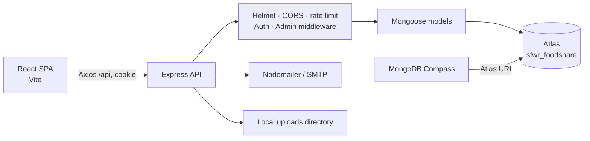

# Smart Food Waste Reducer

A full-stack community food-sharing application built with **MongoDB, Express, React, and Node.js**. People can share surplus food, request available listings, and track food intake. Administrators review requests and manage the community and site content.

This MERN edition is a standalone sibling to the original Laravel application. It uses the MongoDB database **`sfwr_foodshare`**.

## Features

**Public:** browse and search listings, filter by category, view listing details, and send contact messages.

**User:** create an account and sign in, manage a profile and photo, create/edit/delete owned food listings, request food, track claim status, maintain a food-intake journal, manage calorie/expense/reminder trackers, and optionally enable authenticator-app 2FA.

**Admin:** dashboard metrics, manage food listings and users, review/approve/reject claims, manage page headings, read contact messages, and reply through configured SMTP email.

## Stack and architecture

- **Client:** React 18, React Router, Vite, Bootstrap 5 utilities/components, Axios, Lucide icons.
- **API:** Node.js, Express, Mongoose.
- **Database:** MongoDB Atlas, database `sfwr_foodshare`.
- **Authentication:** bcrypt password hashes, JWT in an HTTP-only cookie, server-side Admin authorization, optional TOTP 2FA.
- **Email:** Nodemailer over SMTP. Email delivery requires valid SMTP settings.
- **Uploads:** validated image uploads (JPG, PNG, WEBP, AVIF; maximum 2 MB) saved under `server/uploads` for local development.



## Database design

Mongoose stores documents in these collections. Relationships use MongoDB ObjectIds; API responses populate related display fields where needed.

| Collection | Purpose                                   | Relationships / notes                                                                    |
| ---------- | ----------------------------------------- | ---------------------------------------------------------------------------------------- |
| `users`    | Accounts, role, profile, 2FA settings     | Unique email; password and 2FA secret are excluded from normal queries                   |
| `foods`    | Community and sample food listings        | References the listing owner and optional intake                                         |
| `claims`   | Requests for food and review status       | References a food listing and requesting user; only one pending request per user/listing |
| `intakes`  | Food journal entries                      | References the user and optionally a food listing                                        |
| `contacts` | Public contact messages and admin replies | Reply is sent by SMTP when configured                                                    |
| `headers`  | Admin-managed page headings               | Page type is `admin` or `user`                                                           |
| `trackers` | Calorie, expense, and reminder records    | Owned by a user and separated by tracker kind                                            |

## Atlas and Compass setup

1. In Atlas, create/choose your cluster, allow your current IP in **Database & Network Access → IP Access List**, and create a database user with read/write access to `sfwr_foodshare`.
2. Copy `.env.example` to `server/.env` and set `MONGODB_URI` to the Atlas Drivers URI. Put `sfwr_foodshare` after the cluster hostname as the database path. Keep the completed URI private; URL-encode special characters in the database-user password.
3. In `server/.env`, set a unique `JWT_SECRET` (at least 32 characters) and `ADMIN_PASSWORD` (at least 12 characters). For real email, configure `SMTP_HOST`, `SMTP_PORT`, `SMTP_USER`, `SMTP_PASS`, `MAIL_FROM`, and `CONTACT_TO`.
4. In Compass, create a **New Connection**, paste the same Atlas URI, and connect. After seeding, refresh Compass and expand `sfwr_foodshare` to inspect its collections and documents.

## Install and run

Use Node.js 20 or newer. From this project folder:

```bash
cp .env.example server/.env
# Edit server/.env with your private Atlas URI and unique secrets.
npm install
npm install --prefix server
npm install --prefix client
npm run seed
npm run dev
```

The seed command creates or promotes the configured Admin account and loads/refreshes the attributed sample food catalog. Sample listings use distinct Munich pickup locations and November expiry dates. The sample-image files are served from `client/public/foods/demo-catalog`.

Development URLs default to React at `http://localhost:5174` and the API at `http://localhost:5002`. If Vite reports that the client port is busy, open the URL Vite prints; set `CLIENT_URL` in `server/.env` to that exact client origin and restart the API if needed.

Sign in using `ADMIN_EMAIL` and `ADMIN_PASSWORD` from `server/.env`. Never commit `server/.env`; it is ignored by Git.

## Demo and implementation notes

See [docs/architecture.md](docs/architecture.md) for the API and authorization map, and [docs/interview-demo.md](docs/interview-demo.md) for a presentation walkthrough and interview talking points.

- SMTP-dependent email replies only work when valid SMTP credentials are configured.
- Uploaded profile and food images are stored on the API server's disk in development. A deployed app should use persistent object storage.
- The Atlas database user should be limited to the `sfwr_foodshare` database for a production deployment.
